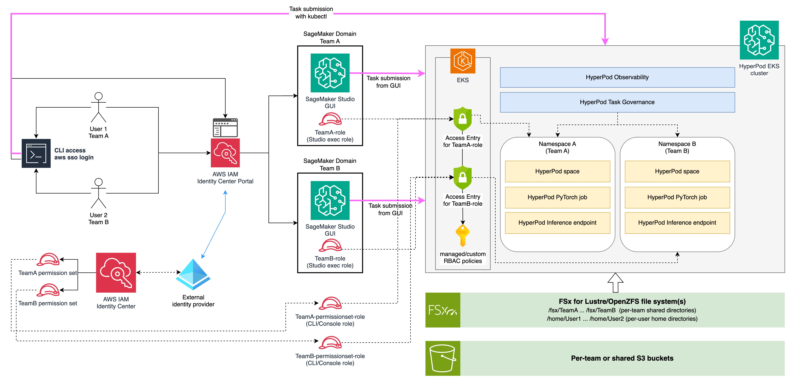
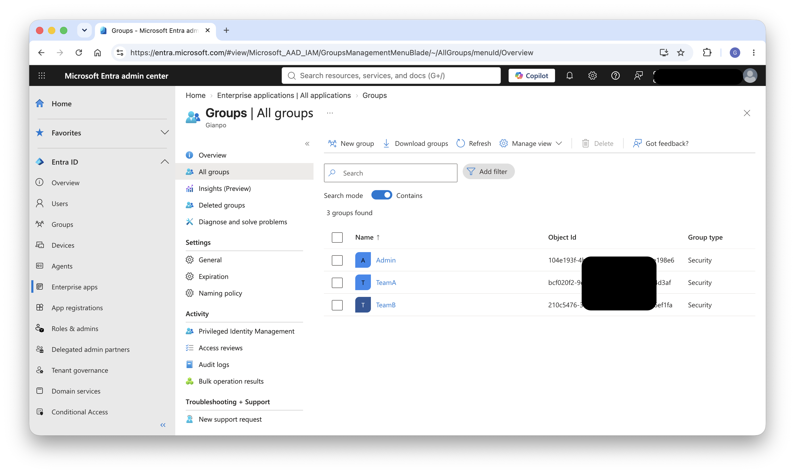
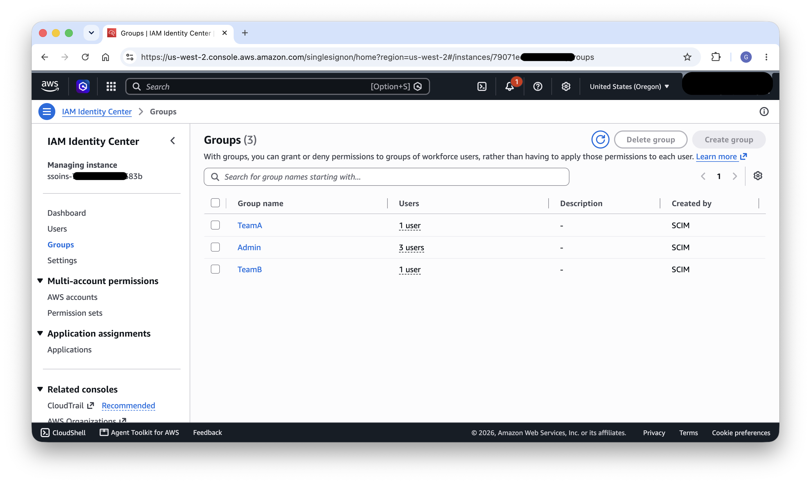
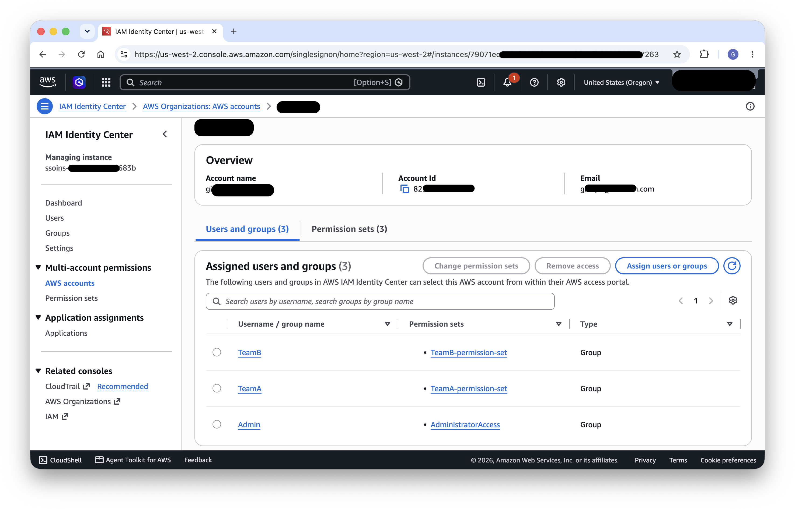
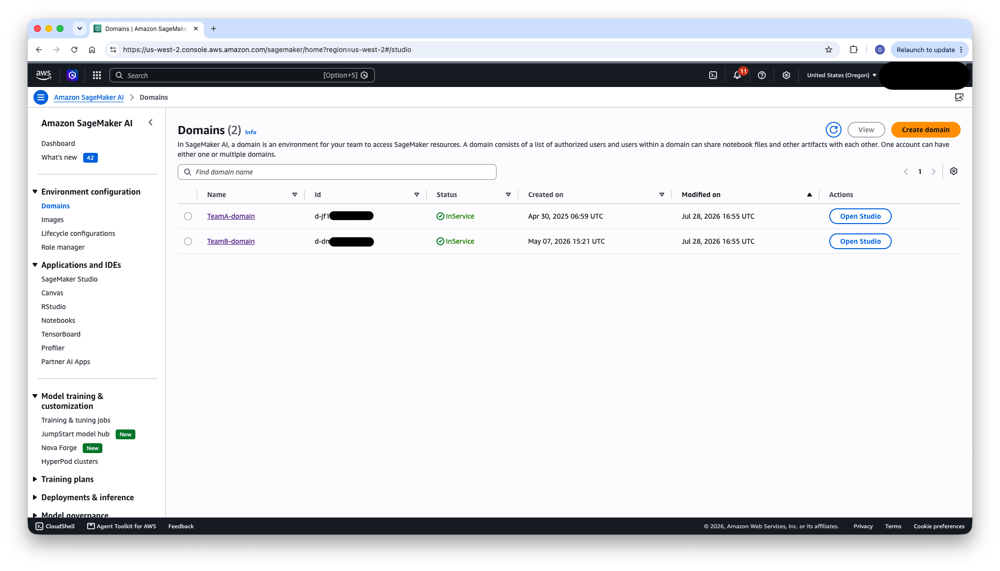
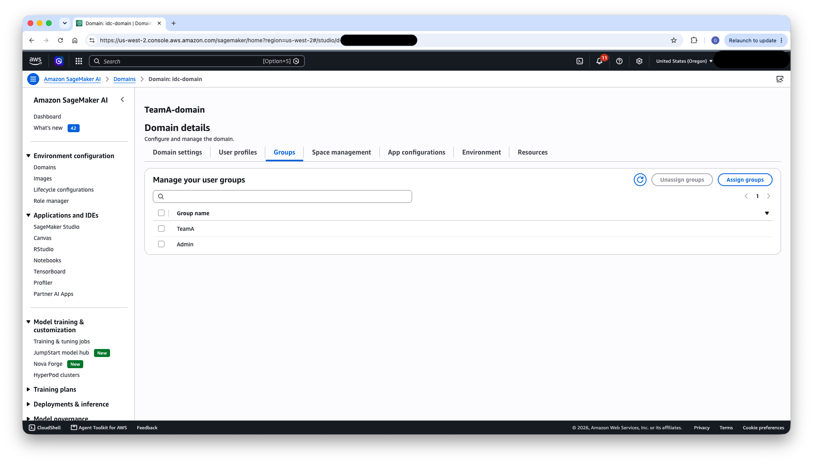
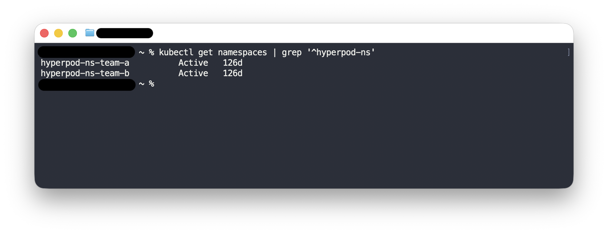
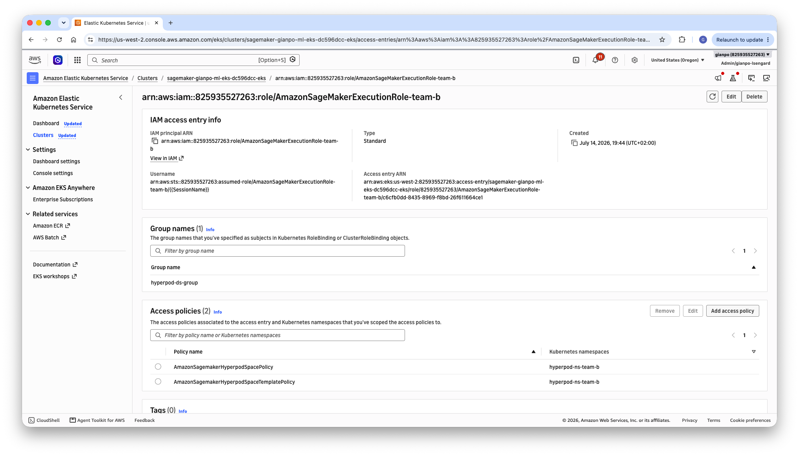
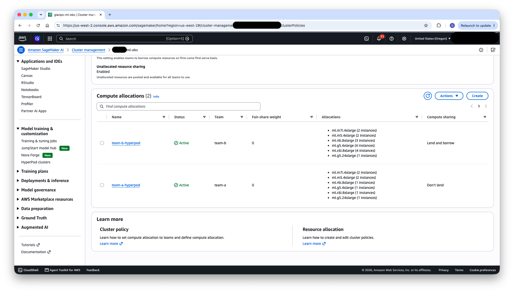
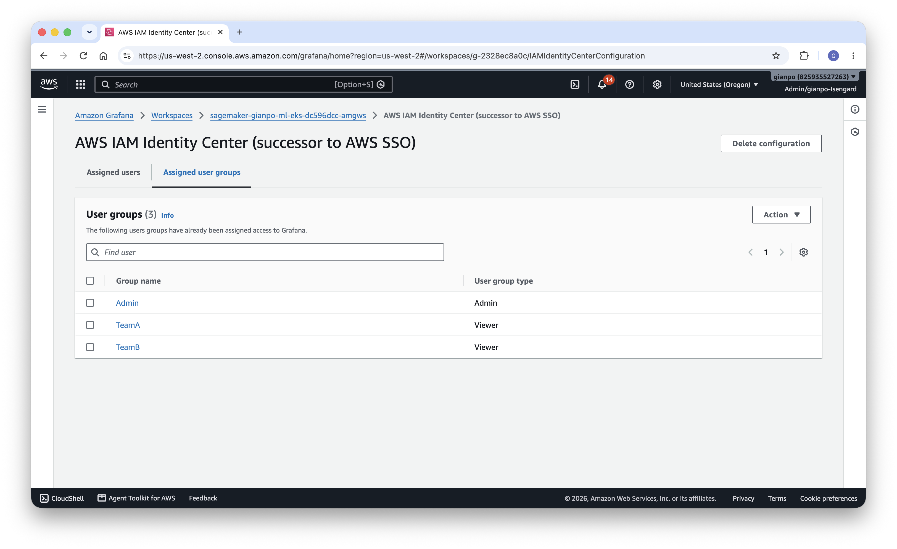

# Multi-Tenant Architectures with Amazon SageMaker HyperPod EKS

## Introduction

Amazon SageMaker HyperPod is a purpose-built AI service that simplifies the management of large-scale compute clusters for generative AI (gen AI) workloads. It provides resilient, optimized clusters with Kubernetes (Amazon EKS) or Slurm orchestration, enabling organizations to run distributed training, interactive development, and model inference at scale — while automatically handling node health monitoring, fault recovery, and cluster lifecycle management.

As organizations scale their gen AI operations, a common challenge emerges: multiple teams within the same company need shared access to expensive GPU clusters while maintaining isolation boundaries, resource fairness, and operational independence. A data science team training large language models, a computer vision group running inference workloads, and a research team experimenting with new model architectures — all may need access to the same HyperPod cluster. Without a well-designed multi-tenant architecture, organizations face uncontrolled resource consumption, weak isolation between teams, an inability to attribute shared GPU costs to the teams that incur them, and administrative overhead that slows down innovation.

In this post, we present a reference architecture for building a multi-tenant environment on Amazon SageMaker HyperPod with EKS. This architecture leverages AWS Identity Center for centralized authentication, per-team SageMaker Domains for a tailored user experience, Kubernetes namespaces for workload isolation, HyperPod Task Governance for fair resource allocation, and namespace-level cost allocation for per-team spend visibility and chargeback. By the end of this guide, you will have a clear blueprint for enabling multiple teams to efficiently share a single HyperPod EKS cluster.

## Architecture Overview

The following diagram illustrates the high-level architecture of a multi-tenant HyperPod EKS deployment. In this example, two teams — Team A and Team B — share a single HyperPod EKS cluster, each operating within their own isolated namespace.



The architecture is structured as a layered flow from left to right, connecting user identity through authorization controls and into isolated workload namespaces on the cluster.

**Users and authentication (left side).** On the far left, individual users from each team (User 1 from Team A, User 2 from Team B) interact with the system through two paths. Both paths authenticate through the AWS IAM Identity Center Portal, which federates with an external identity provider (such as Microsoft Entra ID) shown at the bottom-left. The first path is via CLI access, where users authenticate using `aws sso login` — which redirects them to the Identity Center portal for authentication — and then obtain temporary credentials from their team's permission set to submit tasks directly to the EKS cluster with `kubectl` (shown by the pink arrow flowing from the CLI terminal across the top of the diagram directly into the HyperPod EKS cluster). The second path is through the Identity Center portal directly, where users select the SageMaker Studio application to log in to their team-specific SageMaker Domain. Each team has a corresponding permission set (TeamA permission set, TeamB permission set) that carries the IAM policies needed for CLI workflows. Identity Center automatically provisions an IAM role for each permission set — shown in the diagram as TeamA-permissionset-role and TeamB-permissionset-role (labeled "CLI/Console role") — which serves as the IAM principal when users authenticate via `aws sso login`.

**SageMaker Domains (center-left).** From the Identity Center portal, users are routed to their team-specific SageMaker Domain. Each domain — SageMaker Domain Team A and SageMaker Domain Team B — provides a dedicated SageMaker Studio GUI and is configured with a team-specific execution role (TeamA-role and TeamB-role respectively). These domains serve as the primary workspace interface, enabling users to submit tasks from the GUI (shown by the pink arrows flowing toward EKS).

**EKS access control (center).** At the EKS boundary, access entries map IAM roles to Kubernetes permissions. The diagram shows Access Entries for TeamA-role and TeamB-role (the Studio execution roles), which authorize requests originating from the SageMaker Studio GUI. Additionally, access entries must be configured for the IDC-provisioned CLI/Console roles (TeamA-permissionset-role and TeamB-permissionset-role) to authorize requests arriving via `kubectl`. All access entries are associated with managed or custom RBAC policies (represented by the key icon) and scoped to the team's designated namespace, ensuring that regardless of whether access originates from Studio or the CLI, users can only interact with resources in their own namespace.

**HyperPod EKS cluster (right side).** The cluster itself is depicted with two cross-cutting platform layers at the top: HyperPod Observability (for monitoring and dashboards) and HyperPod Task Governance (for compute quota management and scheduling priorities). Below these layers, the cluster is partitioned into Namespace A (Team A) and Namespace B (Team B). Within each namespace, teams can run their own HyperPod Spaces (interactive development environments), HyperPod PyTorch jobs (distributed training workloads), and HyperPod Inference endpoints (model serving).

**Storage (bottom).** Beneath the cluster, the architecture shows two storage tiers. The first is a POSIX-compliant file system (FSx for Lustre or OpenZFS) organized into per-team shared directories (`/fsx/TeamA`, `/fsx/TeamB`) and per-user home directories (`/home/User1`, `/home/User2`). The second is per-team or shared Amazon S3 buckets for object storage, governed by the team's IAM execution role.

This architecture ensures that the entire flow — from authentication through authorization to workload execution — maintains team isolation while sharing expensive GPU infrastructure efficiently.

## Authentication and Access Control

The foundation of any multi-tenant system is robust authentication: verifying who users are before they interact with any resource. In this architecture, AWS IAM Identity Center serves as the centralized authentication layer, federating with an external identity provider to manage user identities and group memberships.

### Why AWS IAM Identity Center

AWS IAM Identity Center (successor to AWS Single Sign-On) provides a single place to manage workforce identities across AWS accounts and applications. For a multi-tenant HyperPod deployment, it offers several critical capabilities:

- **Centralized identity management** — Rather than maintaining separate user databases per AWS service, Identity Center provides a single source of truth for all user identities and their group memberships.
- **Federation with existing identity providers** — Most enterprises already manage their workforce identities in systems like Microsoft Entra ID (formerly Azure AD), Okta, or Ping Identity. Identity Center integrates with these providers, allowing organizations to reuse their existing identity infrastructure without duplicating user accounts.
- **Native integration with SageMaker** — SageMaker Domains support Identity Center authentication out of the box, enabling seamless single sign-on from the corporate identity provider directly into SageMaker Studio.
- **AWS account access** — Identity Center can also grant users access to the underlying AWS account with specific permission sets, enabling CLI workflows alongside the Studio GUI experience.
- **Required for Amazon Managed Grafana** — Amazon Managed Grafana uses Identity Center as its authentication mechanism for workforce users, making it the natural choice when teams also need access to observability dashboards for monitoring their workloads.

*Learn more: [What is IAM Identity Center](https://docs.aws.amazon.com/singlesignon/latest/userguide/what-is.html)*

### Configuring Identity Center with an External Identity Provider

In this reference architecture, we use Microsoft Entra ID as the external identity provider, though the same pattern applies to any SAML 2.0 or SCIM-compatible provider.

The configuration involves:

1. **Group structure in the identity provider** — In Entra ID, create groups that correspond to your organizational teams. In our example, we define three groups: `TeamA`, `TeamB`, and `Admin`. Each group contains the users belonging to that team (for example, `user1-teamA@domain.com` in the TeamA group).

2. **SCIM provisioning** — Enable SCIM (System for Cross-domain Identity Management) synchronization between Entra ID and AWS IAM Identity Center. SCIM provides automatic provisioning and de-provisioning of users and groups. When a new user is added to the TeamA group in Entra ID, they are automatically synchronized to Identity Center and gain the appropriate access without manual intervention.

3. **SAML-based authentication** — Configure SAML 2.0 federation so that when users authenticate, they do so against Entra ID. Identity Center acts as the service provider, trusting the assertions from your Entra ID tenant.

This configuration ensures that team membership — which drives all downstream authorization decisions — is managed in your existing corporate directory and automatically propagated to AWS.


*Figure: Team-based group structure in Microsoft Entra ID, with dedicated groups for `TeamA`, `TeamB`, and `Admin` that map to organizational teams.*


*Figure: Corresponding groups in AWS IAM Identity Center, automatically provisioned from Entra ID via SCIM synchronization.*

*Learn more: [Connect an external identity provider](https://docs.aws.amazon.com/singlesignon/latest/userguide/manage-your-identity-source-idp.html) · [SCIM profile and SAML 2.0 implementation](https://docs.aws.amazon.com/singlesignon/latest/userguide/scim-profile-saml.html)*

## Authorization

With authentication established, the next layer is authorization: controlling what actions each team can perform across AWS services and the Kubernetes cluster. Authorization in this architecture operates at two levels — AWS IAM for service-level access, and Kubernetes RBAC for cluster-level access.

### Per-Team IAM Roles

Each team requires a dedicated IAM role that encapsulates the AWS-level permissions needed for their AI/ML workflows. These roles serve as the SageMaker Domain execution role and define what AWS services the team can access.

A typical team IAM role should include policies granting access to:

- **Amazon SageMaker** — For managing HyperPod clusters, MLflow tracking servers, and other SageMaker resources through the SageMaker API.
- **Amazon S3** — For reading training datasets and writing model artifacts, checkpoints, and logs. Scope these permissions to team-specific bucket prefixes.
- **Amazon CloudWatch** — For viewing logs and metrics related to the team's workloads.
- **Amazon EKS** — Specifically, the `eks:AccessKubernetesApi` and `eks:MutateViaKubernetesApi` permissions, which are critical for enabling the SageMaker Studio GUI to make Kubernetes API calls on behalf of the user (for example, listing Spaces or submitting jobs).

The trust policy on each IAM role must include `sagemaker.amazonaws.com` as a trusted principal, allowing SageMaker to assume the role on behalf of users when they operate through Studio. CLI access via Identity Center uses a separate permission set with its own policies (see "AWS Account Access via Identity Center" below), allowing CLI permissions to be independently scoped.

*Learn more: [How to use SageMaker AI execution roles](https://docs.aws.amazon.com/sagemaker/latest/dg/sagemaker-roles.html)*

### AWS Account Access via Identity Center

Beyond SageMaker Studio, teams often need direct AWS account access for CLI operations — running `kubectl` commands, scripting workflows, or accessing resources programmatically. Identity Center permission sets provide this capability.

For the **Admin** group, assign a permission set with administrative access as required by your company policies, granting the necessary account access for cluster management and administrative operations.

For **Team A** and **Team B**, create permission sets with inline or managed policies that grant the permissions needed for CLI workflows directly. A typical team permission set includes permissions for `eks:AccessKubernetesApi` (to view Kubernetes resources from AWS Console), scoped S3 access for the team's data, and CloudWatch read access for monitoring. These policies are defined independently from the Studio execution role, allowing administrators to tailor CLI permissions to the specific operations teams perform from the command line.

Users retrieve temporary credentials via the AWS CLI using `aws sso login`, which they can then use to configure `kubectl` for direct interaction with the EKS cluster.


*Figure: Per-team permission sets in AWS IAM Identity Center, providing scoped AWS account access for CLI workflows such as running `kubectl` and `aws sso login` against the EKS cluster.*

*Learn more: [Manage AWS accounts with permission sets](https://docs.aws.amazon.com/singlesignon/latest/userguide/permissionsetsconcept.html)*

### Configuring the AWS CLI

Team members configure the AWS CLI to authenticate via Identity Center by running `aws configure sso`. This creates profiles in `~/.aws/config` that reference the appropriate Identity Center session and permission set. Each team member uses their team-specific profile when interacting with the cluster from the command line, ensuring that authorization boundaries are maintained whether access originates from Studio or from a local terminal.

The resulting configuration defines a shared `sso-session` block for the Identity Center portal and one named profile per team, each pointing at that team's permission set. Team members then run `aws sso login --profile <team>` to obtain temporary credentials scoped to their permission set:

```ini
[sso-session my-sso]
sso_start_url = https://d-xxxxxxxxxx.awsapps.com/start
sso_region = us-west-2
sso_registration_scopes = sso:account:access

[default]
sso_session = my-sso
sso_account_id = 123456789012
sso_role_name = AdministratorAccess
region = us-west-2

[profile team-a]
sso_session = my-sso
sso_account_id = 123456789012
sso_role_name = TeamA-permission-set
region = us-west-2

[profile team-b]
sso_session = my-sso
sso_account_id = 123456789012
sso_role_name = TeamB-permission-set
region = us-west-2
```

*Learn more: [Configuring IAM Identity Center authentication with the AWS CLI](https://docs.aws.amazon.com/cli/latest/userguide/cli-configure-sso.html)*

## SageMaker Domains

SageMaker Domains provide the workspace boundary for each team, offering a tailored user experience, pre-configured execution roles, and built-in integration with Identity Center authentication.

### Why SageMaker Domains

Using one SageMaker Domain per team is a well-established pattern for organizing multi-team environments. This approach offers several advantages:

- **Established multi-team pattern** — AWS has documented this approach extensively for separating lines of business or teams with multiple domains, making it a proven and supported configuration.
- **Native Identity Center authentication** — Each domain can be configured with Identity Center authentication, meaning users sign in once through their corporate identity provider and land directly in their team's Studio environment.
- **Built-in team configuration** — Domains already provide mechanisms to specify configurations for users and teams without requiring additional custom entities. For example, settings like team role can be specified at domain level, and overridden at user profile level for maximum flexibility.
- **Navigation customization** — Domain settings allow administrators to hide navigation items that are not relevant to the team's workflows, presenting a focused interface tailored to HyperPod use cases.

*Learn more: [SageMaker AI domain entities and statuses](https://docs.aws.amazon.com/sagemaker/latest/dg/sm-domain.html) · [Multiple domains overview](https://docs.aws.amazon.com/sagemaker/latest/dg/domain-multiple.html)*

### Setting Up Per-Team Domains

Create one SageMaker Domain per team with Identity Center authentication. In our example, we create `TeamA-domain` and `TeamB-domain`. Each domain is configured as follows:

1. **Default execution role** — Set the domain's default execution role to the team-specific IAM role created in the authorization step. This ensures that all actions performed through Studio inherit the appropriate permissions.

2. **Identity Center group assignment** — Add the corresponding Identity Center group (e.g., the `TeamA` group) to the domain. This enables the SageMaker Studio application for all members of that group, granting them access to the domain's Studio interface.

3. **Application assignment verification** — After configuring group access, review the application assignment in Identity Center to confirm that the correct groups are mapped to the correct domains.

4. **Navigation customization** — Configure the default navigation settings for each domain to present only the relevant capabilities. For example, you might hide items not related to HyperPod workflows, providing a streamlined "HyperPod-focused" user experience that reduces cognitive overhead for team members who only need to work with HyperPod resources.


*Figure: The SageMaker console showing one domain per team (`TeamA-domain` and `TeamB-domain`), each providing an isolated workspace boundary.*


*Figure: Detail of `TeamA-domain`, showing the assigned Identity Center groups.*

## HyperPod EKS Cluster Configuration

The HyperPod EKS cluster is where workloads actually execute. Multi-tenancy at the cluster level is achieved through Kubernetes namespaces for isolation and EKS access entries for authorization.

### Namespace Isolation

Create a dedicated Kubernetes namespace for each team — for example, `hyperpod-ns-team-a` and `hyperpod-ns-team-b`. Namespaces provide a logical boundary within the cluster, ensuring that each team's workloads (Spaces, training jobs, inference endpoints) are isolated from one another.

> **Note: Namespaces are an isolation boundary, not a hard security boundary.**
> The multi-tenancy model in this architecture is *multi-team within a single organization* — separate teams that share the same cluster and operate under a common administrative domain and a baseline level of mutual trust. It is not designed for *multi-customer* isolation, where mutually untrusted tenants require strong, adversarial security guarantees.
>
> This distinction matters because namespaces, RBAC, and quotas are effective at preventing *accidental* interference — teams overwriting each other's resources, consuming more than their allocated compute, or listing workloads outside their scope. They do not, on their own, constitute a defense against a determined malicious tenant. Namespaced pods can still share the same underlying nodes and kernel, and cluster-scoped resources (nodes, `PersistentVolume`s, `CustomResourceDefinition`s, and some operator components) live outside any single namespace. A tenant that must be treated as hostile could potentially exploit shared infrastructure, node-level access, or misconfigured cluster-scoped permissions to affect others.
>
> If your requirements involve untrusted tenants or strict regulatory isolation, consider stronger boundaries such as separate clusters or accounts per tenant, dedicated node pools, and runtime sandboxing. For the multi-team scenario described here, namespace-based isolation combined with RBAC, Task Governance quotas, and the POSIX identity controls described later provides an appropriate balance of separation and operational simplicity.

Namespaces can be created manually with `kubectl create namespace` or provisioned automatically through HyperPod Task Governance, which manages namespaces as part of its quota and scheduling configuration.


*Figure: The cluster's namespaces, with one dedicated namespace per team (`hyperpod-ns-team-a` and `hyperpod-ns-team-b`) providing workload isolation.*

*Learn more: [Kubernetes namespaces](https://kubernetes.io/docs/concepts/overview/working-with-objects/namespaces/)*

### Network Isolation

Namespaces do not restrict network traffic. By default, Kubernetes networking is flat — every pod can reach every other pod across all namespaces — so a pod in `hyperpod-ns-team-a` can open a connection to a pod in `hyperpod-ns-team-b` unless you add controls. To scope pod-to-pod reachability along team boundaries, use Kubernetes `NetworkPolicy` resources.

The recommended pattern is *default-deny* per namespace: start by denying all ingress (and optionally egress), then explicitly allow the traffic each team actually needs — typically intra-namespace communication plus required egress such as DNS, storage endpoints, and AWS APIs. The following example denies all ingress in a team's namespace and then allows traffic only from pods within the same namespace:

```yaml
# 1. Default-deny all ingress in the team's namespace.
apiVersion: networking.k8s.io/v1
kind: NetworkPolicy
metadata:
  name: default-deny-ingress
  namespace: hyperpod-ns-team-a
spec:
  podSelector: {}          # applies to all pods in the namespace
  policyTypes:
    - Ingress
---
# 2. Allow ingress only from pods within the same namespace.
apiVersion: networking.k8s.io/v1
kind: NetworkPolicy
metadata:
  name: allow-same-namespace
  namespace: hyperpod-ns-team-a
spec:
  podSelector: {}
  policyTypes:
    - Ingress
  ingress:
    - from:
        - podSelector: {}  # any pod in this namespace
```

`NetworkPolicy` enforcement depends on a CNI that supports it. On EKS, you can enable network policy support in the Amazon VPC CNI.

As with namespaces, NetworkPolicies reduce *accidental* cross-team reachability and shrink blast radius, but they are not by themselves an adversarial security boundary on shared nodes. For stronger separation, consider dedicated node pools per team or separate clusters, as noted above.

*Learn more: [Kubernetes network policies](https://kubernetes.io/docs/concepts/services-networking/network-policies/) · [Amazon VPC CNI network policy](https://docs.aws.amazon.com/eks/latest/userguide/cni-network-policy.html)*

### EKS Access Entries

EKS access entries connect IAM principals to Kubernetes RBAC permissions. For each team, create two access entries:

- **Studio access entry** — The IAM principal is the team's SageMaker Domain execution role. This entry is used when actions originate from the SageMaker Studio GUI.
- **CLI access entry** — The IAM principal is the SSO-provisioned role created by Identity Center for the team's permission set (following the pattern `AWSReservedSSO_<permission-set-name>_<unique-id>`). This entry is used when users interact with the cluster via `kubectl`.

Both entries are scoped to the team's namespace with managed or custom Kubernetes policies. For example, both Team A entries grant permissions only within `hyperpod-ns-team-a`. The two entries can carry different RBAC policies if desired — for instance, the CLI entry might restrict write access to certain resource types while the Studio entry allows full access.

This scoping ensures that whether access originates from Studio or from the CLI, users can only interact with resources in their own namespace. Attempting to list or modify resources in another team's namespace results in a Kubernetes `Forbidden` error.

For more advanced scenarios, you can use Kubernetes groups in the access entry to map users to custom ClusterRoles or Roles that provide fine-grained permissions beyond the standard managed policies.


*Figure: An EKS access entry for Team B's role, scoped down to the `hyperpod-ns-team-b` namespace so its permissions apply only within Team B's namespace.*

*Learn more: [Grant IAM users access to Kubernetes with EKS access entries](https://docs.aws.amazon.com/eks/latest/userguide/access-entries.html)*

### HyperPod Task Governance

When Task Governance is enabled on the cluster, it provides an additional layer of resource management:

- **Compute quotas** — Define how much GPU and CPU capacity each team can consume. This prevents a single team from monopolizing shared hardware during training runs.
- **Priorities** — Assign scheduling priorities to each team or workload type, allowing critical production inference workloads to preempt experimental training jobs when resources are constrained.
- **Fair scheduling** — Task Governance ensures that when multiple teams are competing for resources, allocation follows the configured policies rather than a first-come-first-served model.

Configure Task Governance with appropriate quotas and priorities per team namespace, balancing between guaranteed minimum allocations and burst capacity for bursty workloads.


*Figure: Task Governance compute allocations for the two teams, with each team's namespace assigned its own quota of cluster compute capacity.*

*Learn more: [SageMaker HyperPod task governance](https://docs.aws.amazon.com/sagemaker/latest/dg/sagemaker-hyperpod-eks-operate-console-ui-governance.html)*

## Storage

Shared storage is a critical component of multi-tenant AI/ML environments. Teams need high-performance file systems for training data, checkpoints, and model artifacts, while maintaining appropriate access boundaries between teams.

### POSIX-Compliant File Systems

For workloads that require a shared, high-performance POSIX file system — which is common for distributed training where multiple nodes read the same dataset or write checkpoints — consider the following options:

- **Amazon FSx for Lustre** — Provides high-throughput, low-latency parallel file system access, ideal for large-scale training workloads that need to read large datasets at high speed.
- **Amazon FSx for OpenZFS** — Offers a general-purpose file system with strong POSIX semantics, snapshots, and compression. Well-suited for workloads that need traditional file system features alongside high performance.
- **Amazon EFS** — Provides fully managed, elastic NFS storage. EFS also supports access points, which can simplify per-team directory isolation by mapping different mount points to different directories with enforced UIDs and GIDs.

The storage layout typically follows this structure:

- **Per-team shared directories** — Each team has a shared directory (e.g., `/fsx/TeamA`, `/fsx/TeamB`) for datasets, models, and artifacts that all team members need to access.
- **Per-user home directories** — Each user has a personal home directory (e.g., `/home/User1`, `/home/User2`) for individual work, experiments, and notebooks.

The POSIX permission model on these file systems relies on UIDs, GIDs, and supplemental groups to enforce access boundaries.
These POSIX identities should then be propagated to the pod's security context when a user launches a HyperPod Space or submits a training job, ensuring that file system access respects the configured ownership and permissions.
We recommend using a Kubernetes mutating admission webhook to retrieve POSIX identity information from your identity store at runtime when a workload is submitted, and modify the security context of the Pod accordingly.

```python
# 1. Extract the username (user@domain.com) from the admission request.
#    When using AWS Identity Center with EKS, it gets propagated in userInfo.extra["sessionName"].
def extract_username(admission_request):
    extra = admission_request["userInfo"]["extra"]
    ...
    return extra["sessionName"][0]

# 2. Look up the POSIX identity from a mapping table (e.g. DynamoDB).
def lookup_posix_identity(username):
    item = posix_table.get_item(Key={"username": username})["Item"]
    ...
    return {
        "uid": int(item["uid"]),
        "gid": int(item["gid"]),
        "supplementalGroups": [int(g) for g in item["supplementalGroups"]],
    }

# 3. Patch the Pod security context with the resolved POSIX identity.
def build_security_context_patch(pod, posix):
    ...
    return [{
        "op": "add",
        "path": "/spec/securityContext",
        "value": {
            "runAsUser": posix["uid"],
            "runAsGroup": posix["gid"],
            "fsGroup": posix["gid"],
            "supplementalGroups": posix["supplementalGroups"],
        },
    }]
```

See [`scripts/posix_mutating_webhook.py`](scripts/posix_mutating_webhook.py) for a more complete illustrative snippet, including the admission handler that ties these steps together.

*Learn more: [FSx for Lustre](https://docs.aws.amazon.com/fsx/latest/LustreGuide/what-is.html) · [FSx for OpenZFS](https://docs.aws.amazon.com/fsx/latest/OpenZFSGuide/what-is-fsx.html) · [Amazon EFS](https://docs.aws.amazon.com/efs/latest/ug/whatisefs.html)*

### Amazon S3 Storage

For object storage, access to S3 buckets is governed by the team's IAM execution role. You can create per-team buckets or use a shared bucket with per-team prefixes, relying on IAM policies to enforce isolation. Pods within the cluster need appropriate service accounts configured with IAM Roles for Service Accounts (IRSA) or Pod Identity to authenticate to S3. For simplicity, you can associate the same execution role configured on the SageMaker Domain to a Kubernetes service account within the team's namespace, providing consistent S3 access from both Studio and cluster workloads.

*Learn more: [IAM roles for service accounts (IRSA)](https://docs.aws.amazon.com/eks/latest/userguide/iam-roles-for-service-accounts.html) · [EKS Pod Identity](https://docs.aws.amazon.com/eks/latest/userguide/pod-identities.html)*

## HyperPod Spaces

HyperPod Spaces provide interactive development environments (IDEs) running directly on cluster nodes. In a multi-tenant setting, Spaces must be properly scoped to each team's namespace and configured with appropriate resource templates.

### Space Templates

Create namespace-scoped Space templates for each team. These templates define the resource configurations (instance types, storage volumes, environment variables) available to team members when creating Spaces. By scoping templates to a namespace, you ensure that each team can only launch Spaces within their designated boundary.

When HyperPod Task Governance is enabled, templates should include the default labels required by the governance system (such as team identifier and priority labels). The cluster administrator pre-configures these labels so that team members do not need to specify them manually when launching Spaces.

The example below shows a JupyterLab Space template scoped to Team A. The team-specific parts are the `metadata.namespace`, the Task Governance queue label under `baseLabels`, and the `defaultVolumes` that mount the team's shared file system and the user's home directory:

```yaml
apiVersion: workspace.jupyter.org/v1alpha1
kind: WorkspaceTemplate
metadata:
  name: jl-smd-custom
  namespace: hyperpod-ns-team-a          # scopes the template to Team A's namespace
spec:
  displayName: "JupyterLab (team-a)"
  description: "SageMaker Distribution"
  appType: jupyterlab
  baseLabels:
  - key: kueue.x-k8s.io/queue-name       # Task Governance (Kueue) local queue for Team A
    value: hyperpod-ns-team-a-localqueue
  ...
  # container command, default CPU/memory resources, security context, access type, etc.
  ...
  defaultVolumes:
    - name: home-dir                     # per-user home directory
      mountPath: /home
      persistentVolumeClaimName: fsx-openzfs-claim
    - name: shared-data                  # Team A's shared directory
      mountPath: /fsx
      persistentVolumeClaimName: fsx-lustre-claim
  ...
  # primary (EBS) storage defaults and limits
  ...
```

### Persistent Volume Claims

Create the appropriate Persistent Volume Claims (PVCs) in each team's namespace, referencing the shared file system. These PVCs mount the team's shared directory and the user's home directory into the Space, providing access to training data, checkpoints, and personal workspaces.

### Owner-Only vs. Shared Spaces

Consider your organization's requirements around Space sharing:

- **Owner-only Spaces** — Each Space is accessible only by the user who created it. This is the default and most secure configuration, appropriate when teams work on sensitive or independent projects.
- **Shared Spaces** — Multiple team members can access the same Space, useful for pair programming, collaborative debugging, or shared development environments. When enabling shared Spaces, ensure that POSIX permissions and supplemental groups are configured to allow appropriate access to files created within the Space.

*Learn more: [Interactive development environments on Amazon SageMaker HyperPod EKS clusters](https://docs.aws.amazon.com/sagemaker/latest/dg/sagemaker-hyperpod-eks-cluster-ide.html)*


## HyperPod Training Operator

The HyperPod Training Operator enables teams to submit distributed training jobs as Kubernetes custom resources (for example, HyperPodPyTorchJob). In the multi-tenant architecture, training jobs are namespace-scoped, meaning they automatically inherit the team's isolation boundaries.

Teams can submit training jobs from the CLI using `kubectl apply` with the appropriate job manifest. The job runs in the team's namespace, uses the team's compute quotas (if Task Governance is enabled), and has access to the team's storage volumes.

When Task Governance is enabled, training jobs are subject to the team's allocated quotas and priority settings. If a team has consumed its guaranteed allocation, jobs may be queued until resources become available or until lower-priority workloads are preempted.

The two elements that anchor a job to a team are the `metadata.namespace` (which scopes the job to the team's isolation boundary) and the Task Governance labels. Task Governance is built on Kueue, so the job is routed to the team's local queue via `kueue.x-k8s.io/queue-name` and assigned a scheduling priority via `kueue.x-k8s.io/priority-class`:

```yaml
apiVersion: sagemaker.amazonaws.com/v1
kind: HyperPodPyTorchJob
metadata:
  name: team-a-training-job
  namespace: hyperpod-ns-team-a        # scopes the job to Team A's namespace
  labels:
    kueue.x-k8s.io/queue-name: hyperpod-ns-team-a-localqueue  # Task Governance (Kueue) local queue
    kueue.x-k8s.io/priority-class: training-priority          # scheduling priority for the workload
spec:
  ...
  # replicaSpecs, container image, command, resources, volumes, etc.
  ...
```

*Learn more: [Using the HyperPod training operator](https://docs.aws.amazon.com/sagemaker/latest/dg/sagemaker-eks-operator.html)*

## HyperPod Inference Operator

The HyperPod Inference Operator allows teams to deploy models as inference endpoints directly on the cluster. Similar to training jobs, inference endpoints are namespace-scoped and subject to the team's RBAC policies and Task Governance quotas.

Teams can deploy models from the CLI by creating inference endpoint custom resources in their namespace. The endpoints are isolated per namespace, meaning Team A cannot access or interfere with Team B's inference endpoints.

For production inference workloads that require high availability, consider assigning higher scheduling priority to inference endpoints than to training jobs, ensuring that model serving is not interrupted by batch training workloads.

As with training jobs, the inference endpoint is placed in the team's `metadata.namespace` and carries the Task Governance labels. Here the `kueue.x-k8s.io/priority-class` is set to a higher-priority class so that model serving can preempt batch training when the team's resources are constrained:

```yaml
apiVersion: inference.sagemaker.amazonaws.com/v1alpha1
kind: InferenceEndpointConfig
metadata:
  name: team-a-inference-endpoint
  namespace: hyperpod-ns-team-a        # scopes the endpoint to Team A's namespace
  labels:
    kueue.x-k8s.io/queue-name: hyperpod-ns-team-a-localqueue  # Task Governance (Kueue) local queue
    kueue.x-k8s.io/priority-class: inference-priority         # higher priority than training
spec:
  ...
  # model source, instance type, replica count, autoscaling, etc.
  ...
```

*Learn more: [Deploying models on Amazon SageMaker HyperPod](https://docs.aws.amazon.com/sagemaker/latest/dg/sagemaker-hyperpod-model-deployment.html)*

## HyperPod Observability

Visibility into cluster health, workload performance, and resource utilization is essential for all teams. HyperPod Observability provides built-in monitoring and dashboarding capabilities through Amazon Managed Grafana.

### Configuring Team Access to Grafana

Teams need access to observability dashboards to monitor their workloads, troubleshoot performance issues, and understand resource consumption. However, in a multi-tenant environment, this access should typically be read-only:

1. **Configure Identity Center authentication for Amazon Managed Grafana** — In the Amazon Managed Grafana console, navigate to Authentication and enable AWS IAM Identity Center. This allows users to sign in to Grafana with the same corporate credentials they use for SageMaker Studio.

2. **Assign team groups as Viewers** — Map the Identity Center groups (TeamA, TeamB) to the Grafana Viewer role. This grants team members read-only access to dashboards and metrics without the ability to modify dashboards or data sources.

3. **Admin access** — Assign the Admin group to the Grafana Admin or Editor role, allowing them to create and modify dashboards, configure alerting, and manage data sources.

4. **Team-specific dashboards** — Consider creating dedicated dashboards that filter data by namespace, allowing each team to see only their own workload metrics. Grafana Teams can potentially be leveraged to restrict dashboard visibility to specific groups, providing an additional layer of data isolation.


*Figure: Grafana role assignments in Amazon Managed Grafana. The team groups (TeamA, TeamB) are assigned the Viewer role for read-only access to dashboards and metrics, while the admin group is assigned the Admin role, granting it the ability to create and modify dashboards, configure alerting, and manage data sources.*

*Learn more: [Observability for Amazon SageMaker HyperPod cluster orchestrated by Amazon EKS](https://docs.aws.amazon.com/sagemaker/latest/dg/sagemaker-hyperpod-eks-cluster-observability.html)*

## Cost Allocation and Chargeback

In a multi-tenant environment where teams share expensive GPU infrastructure, understanding who consumes what is essential for accountability, budgeting, and chargeback. [Kubecost](https://github.com/kubecost) addresses this need by breaking down in-cluster spend across native Kubernetes concepts — namespace, label, deployment, and service — and mapping it to organizational concepts like team, project, or environment.

Because this architecture already isolates each team in a dedicated namespace (`hyperpod-ns-team-a`, `hyperpod-ns-team-b`), namespace-level cost allocation aligns directly with team boundaries. This gives platform administrators a clear per-team view of GPU, CPU, memory, storage, and network consumption without any additional workload tagging. For step-by-step instructions on deploying and configuring Kubecost on a HyperPod cluster, see [Kubecost on SageMaker HyperPod](https://awslabs.github.io/ai-on-sagemaker-hyperpod/docs/category/kubecost-on-sagemaker-hyperpod).

### Enabling Team Visibility

Once Kubecost is collecting data, group cost by namespace in the Allocations dashboard to see per-team spend. Because each team owns a namespace, this directly produces a per-team cost breakdown covering compute, memory, storage, and network. Just as with observability dashboards, teams benefit from visibility into their own cost data:

- **Scope views to each team's namespace** — Kubecost supports filtering and saved reports by namespace, so each team can review its own consumption and trends without seeing other teams' data.
- **Set budgets and alerts** — Configure per-namespace budget thresholds and alerts so teams and platform administrators are notified when spend approaches defined limits, supporting the same resource-fairness goals as HyperPod Task Governance.
- **Support chargeback and showback** — Namespace-level allocation reports can feed internal chargeback (billing teams for their usage) or showback (reporting usage without billing) processes, giving finance and platform teams the data they need to attribute shared GPU costs fairly.

```
<Add screenshot from the Kubecost Allocations dashboard grouped by namespace>
```

*Learn more: [Kubecost on SageMaker HyperPod](https://awslabs.github.io/ai-on-sagemaker-hyperpod/docs/category/kubecost-on-sagemaker-hyperpod) · [Kubecost](https://github.com/kubecost)*

## Conclusion

This post presented a reference architecture for building multi-tenant environments on Amazon SageMaker HyperPod with EKS. By combining AWS IAM Identity Center for authentication, per-team IAM roles for AWS-level authorization, SageMaker Domains for a tailored workspace experience, Kubernetes namespaces for workload isolation, HyperPod Task Governance for fair resource allocation, and namespace-level cost allocation for per-team spend visibility, organizations can enable multiple teams to efficiently share a single HyperPod EKS cluster.

This is a flexible, composable approach that combines multiple building blocks into a cohesive solution. The architecture accommodates a variety of use cases and organizational structures. For example, organizations can extend this pattern to connect teams to HyperPod Slurm clusters alongside EKS, providing a unified multi-tenant experience across different orchestration backends — a pattern already proven in production environments.

While this approach requires assembling and configuring several components, the result is a high degree of control and customization that can be tailored to each organization's specific isolation, compliance, and operational requirements; the foundational patterns — identity federation, namespace isolation, RBAC, quota-based governance, and cost allocation — will remain applicable.
