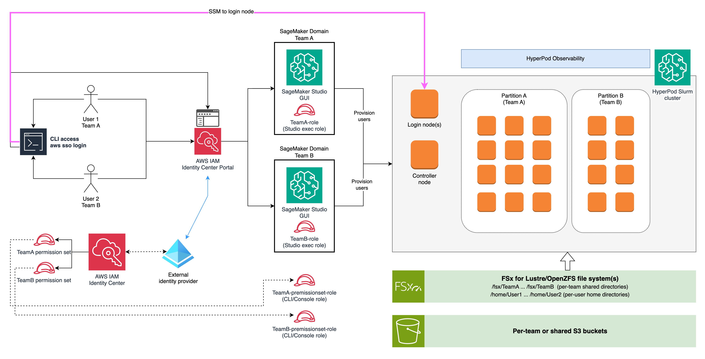

# Multi-Tenant Architectures with Amazon SageMaker HyperPod Slurm

## Introduction

Amazon SageMaker HyperPod is a purpose-built AI service that simplifies the management of large-scale compute clusters for generative AI (gen AI) workloads. It provides resilient, optimized clusters with Kubernetes (Amazon EKS) or Slurm orchestration, enabling organizations to run distributed training, interactive development, and model inference at scale — while automatically handling node health monitoring, fault recovery, and cluster lifecycle management.

As organizations scale their gen AI operations, a common challenge emerges: multiple teams within the same company need shared access to expensive GPU clusters while maintaining security boundaries, resource fairness, and operational independence. A data science team training large language models, a computer vision group running inference workloads, and a research team experimenting with new architectures — all may need access to the same HyperPod cluster. Without a well-designed multi-tenant architecture, organizations face uncontrolled resource consumption, weak isolation between teams, and administrative overhead that slows down innovation.

In this post, we present a reference architecture for building a multi-tenant environment on Amazon SageMaker HyperPod with Slurm. This architecture leverages AWS Identity Center for centralized authentication, per-team SageMaker Domains for user management, Slurm partitions for workload isolation, and Linux user/group permissions for access control. By the end of this guide, you will have a clear blueprint for enabling multiple teams to securely and efficiently share a single HyperPod Slurm cluster.

## Architecture Overview

The following diagram illustrates the high-level architecture of a multi-tenant HyperPod Slurm deployment. In this example, two teams — Team A and Team B — share a single HyperPod Slurm cluster, each operating within their own isolated partition.




The architecture is structured as a layered flow from left to right, connecting user identity through authorization controls and into isolated workload partitions on the cluster.

**Users and authentication (left side).** On the far left, individual users from each team (User 1 from Team A, User 2 from Team B) interact with the system through two paths. Both paths authenticate through the AWS IAM Identity Center Portal, which federates with an external identity provider (such as Microsoft Entra ID) shown at the bottom-left. The first path is via SSM session access, where users authenticate using `aws sso login` and then start an SSM session to the cluster's login node. The `SSMSessionRunAs` attribute configured in the identity provider ensures that SSM sessions are launched with the correct Linux username matching the user's identity. The second path is through the Identity Center portal directly, where users select the SageMaker Studio application to log in to their team-specific SageMaker Domain.

**SageMaker Domains (center-left).** From the Identity Center portal, users are routed to their team-specific SageMaker Domain. Each domain — SageMaker Domain Team A and SageMaker Domain Team B — provides a dedicated SageMaker Studio GUI and is configured with a team-specific execution role (TeamA-role and TeamB-role respectively). These domains serve as the primary workspace interface for managing HyperPod resources and connecting to the cluster.

**Linux user and group management (center).** At the cluster boundary, Linux users and groups enforce access control. Each team maps to a Linux group (derived from the domain name), and each user has a unique UID (from `CustomPosixUserConfig`). The group membership, combined with Slurm's `AllowGroups` directive, determines which partitions each team can access.

**HyperPod Slurm cluster (right side).** The cluster itself is depicted with a head node (controller), login nodes, and compute nodes organized into partitions. HyperPod Observability provides monitoring and dashboards across the cluster. Below, the cluster is partitioned into Partition A (Team A) and Partition B (Team B). The `AllowGroups` Slurm directive on each partition restricts job submission to the corresponding team's Linux group, providing workload isolation.

**Storage (bottom).** Beneath the cluster, the architecture shows two storage tiers. The first is a POSIX-compliant file system (FSx for Lustre or OpenZFS) organized into per-team shared directories (`/fsx/TeamA`, `/fsx/TeamB`) and per-user home directories (`/home/User1`, `/home/User2`). The second is per-team or shared Amazon S3 buckets for object storage, governed by the team's IAM execution role.

This architecture ensures that the entire flow — from authentication through authorization to workload execution — maintains team isolation while sharing expensive GPU infrastructure efficiently.

## Authentication and Access Control

The foundation of any multi-tenant system is robust authentication: verifying who users are before they interact with any resource. In this architecture, AWS IAM Identity Center serves as the centralized authentication layer, federating with an external identity provider to manage user identities and group memberships.

### Why AWS IAM Identity Center

AWS IAM Identity Center (successor to AWS Single Sign-On) provides a single place to manage workforce identities across AWS accounts and applications. For a multi-tenant HyperPod deployment, it offers several critical capabilities:

- **Centralized identity management** — Rather than maintaining separate user databases per AWS service, Identity Center provides a single source of truth for all user identities and their group memberships.
- **Federation with existing identity providers** — Most enterprises already manage their workforce identities in systems like Microsoft Entra ID (formerly Azure AD), Okta, or Ping Identity. Identity Center integrates with these providers, allowing organizations to reuse their existing identity infrastructure without duplicating user accounts.
- **Native integration with SageMaker** — SageMaker Domains support Identity Center authentication out of the box, enabling seamless single sign-on from the corporate identity provider directly into SageMaker Studio.
- **AWS account access** — Identity Center can also grant users access to the underlying AWS account with specific permission sets, enabling SSM session workflows alongside the Studio GUI experience.
- **SSM session identity mapping** — When combined with the `SSMSessionRunAs` attribute, Identity Center ensures that SSM sessions to the cluster are launched under the correct Linux user identity.
- **Required for Amazon Managed Grafana** — Amazon Managed Grafana uses Identity Center as its authentication mechanism for workforce users, making it the natural choice when teams also need access to observability dashboards for monitoring their workloads.

### Configuring Identity Center with an External Identity Provider

In this reference architecture, we use Microsoft Entra ID as the external identity provider, though the same pattern applies to any SAML 2.0 or SCIM-compatible provider.

The configuration involves:

1. **Group structure in the identity provider** — In Entra ID, create groups that correspond to your organizational teams. In our example, we define three groups: `TeamA`, `TeamB`, and `Admin`. Each group contains the users belonging to that team (for example, `user1-teamA@domain.com` in the TeamA group).

2. **SCIM provisioning** — Enable SCIM (System for Cross-domain Identity Management) synchronization between Entra ID and AWS IAM Identity Center. SCIM provides automatic provisioning and de-provisioning of users and groups. When a new user is added to the TeamA group in Entra ID, they are automatically synchronized to Identity Center and gain the appropriate access without manual intervention.

3. **SAML-based authentication** — Configure SAML 2.0 federation so that when users authenticate, they do so against Entra ID. Identity Center acts as the service provider, trusting the assertions from your Entra ID tenant.

4. **SSMSessionRunAs attribute mapping** — In the Entra ID enterprise application configuration, define an additional attribute mapping: `AccessControl:SSMSessionRunAs` mapped to `user.mailnickname`. This ensures that when a user initiates an SSM session to a cluster node, the session runs as the Linux user matching their Entra ID mail nickname (e.g., `user1`). This is critical for maintaining consistent identity between the corporate directory and the Linux user accounts on the cluster.

This configuration ensures that team membership — which drives all downstream authorization decisions — is managed in your existing corporate directory and automatically propagated to AWS, and that SSM sessions automatically map to the correct Linux user identity.

## Authorization

With authentication established, the next layer is authorization: controlling what actions each team can perform across AWS services and the Slurm cluster. Authorization in this architecture operates at two levels — AWS IAM for service-level access, and Linux users/groups combined with Slurm configuration for cluster-level access.

### Per-Team IAM Roles

Each team requires a dedicated IAM role that encapsulates the AWS-level permissions needed for their AI/ML workflows. These roles serve as the SageMaker Domain execution role and define what AWS services the team can access.

A typical team IAM role should include policies granting access to:

- **Amazon SageMaker** — For managing HyperPod resources, cluster connections, and training jobs through the SageMaker API.
- **Amazon S3** — For reading training datasets and writing model artifacts, checkpoints, and logs. Scope these permissions to team-specific bucket prefixes.
- **Amazon CloudWatch** — For viewing logs and metrics related to the team's workloads.
- **AWS Systems Manager (SSM)** — For initiating SSM sessions to the cluster's login nodes. The `ssm:StartSession` permission is required for users to connect to the cluster interactively.

The trust policy on each IAM role must include `sagemaker.amazonaws.com` as a trusted principal, allowing SageMaker to assume the role on behalf of users when they operate through Studio.

### AWS Account Access via Identity Center

Beyond SageMaker Studio, teams need direct AWS account access for SSM session-based workflows (CLI) — connecting to the login nodes, submitting Slurm jobs, and interacting with the cluster interactively. Identity Center permission sets provide this capability.

For the **Admin** group, assign a permission set with administrative access as required by your company policies, granting the necessary account access for cluster management and administrative operations.

For **Team A** and **Team B**, create permission sets with inline or managed policies that grant the permissions needed for SSM-based workflows. A typical team permission set includes permissions for `ssm:StartSession` (to connect to the cluster login nodes), scoped S3 access for the team's data, and CloudWatch read access for monitoring.

Users retrieve temporary credentials via the AWS CLI using `aws sso login`, which they can then use to start SSM sessions to the HyperPod cluster's login nodes.

### Configuring the AWS CLI

Team members configure the AWS CLI to authenticate via Identity Center by running `aws configure sso`. This creates profiles in `~/.aws/config` that reference the appropriate Identity Center session and permission set. Each team member uses their team-specific profile when connecting to the cluster, ensuring that authorization boundaries are maintained and SSM sessions are launched with the correct Linux user identity.

## SageMaker Domains

SageMaker Domains provide the workspace boundary for each team, offering a tailored user experience, pre-configured execution roles, and built-in integration with Identity Center authentication.

### Why SageMaker Domains

Using one SageMaker Domain per team is a well-established pattern for organizing multi-team environments. This approach offers several advantages:

- **Established multi-team pattern** — AWS has documented this approach extensively for separating lines of business or teams with multiple domains, making it a proven and supported configuration.
- **Native Identity Center authentication** — Each domain can be configured with Identity Center authentication, meaning users sign in once through their corporate identity provider and land directly in their team's Studio environment.
- **Built-in team and user configuration** — Domains provide mechanisms to specify configurations for users and teams without requiring additional custom entities. Critically, `CustomPosixUserConfig` can be used to assign specific UIDs and GIDs to users, which serves as the source of truth for Linux user and group creation on the Slurm cluster.
- **Navigation customization** — Domain settings allow administrators to hide navigation items that are not relevant to the team's workflows, presenting a focused interface tailored to HyperPod use cases.

### Setting Up Per-Team Domains

Create one SageMaker Domain per team with Identity Center authentication. In our example, we create `TeamA-domain` and `TeamB-domain`. Each domain is configured as follows:

1. **Default execution role** — Set the domain's default execution role to the team-specific IAM role created in the authorization step. This ensures that all actions performed through Studio inherit the appropriate permissions.

2. **Identity Center group assignment** — Add the corresponding Identity Center group (e.g., the `TeamA` group) to the domain. This enables the SageMaker Studio application for all members of that group, granting them access to the domain's Studio interface.

3. **Application assignment verification** — After configuring group access, review the application assignment in Identity Center to confirm that the correct groups are mapped to the correct domains.

4. **CustomPosixUserConfig at the domain level** — Configure a GID at the domain level that will serve as the primary group ID for all users in that team. For example, Team A's domain might have GID `2001` and Team B's domain GID `3001`. This GID becomes the Linux group ID on the cluster.

5. **CustomPosixUserConfig at the user profile level** — For each user profile within the domain, configure a unique UID. The username is derived from the `SingleSignOnUserValue` attribute of the user profile. For example, if `SingleSignOnUserValue` is `user1@domain.com`, the Linux username would be extracted as `user1`.

6. **Navigation customization** — Configure the default navigation settings for each domain to present only the relevant capabilities, providing a streamlined "HyperPod-focused" user experience.

## HyperPod Slurm Cluster Configuration

The HyperPod Slurm cluster is where workloads actually execute. Multi-tenancy at the cluster level is achieved through Linux user/group management for identity, Slurm partitions for resource isolation, and the `AllowGroups` directive for access control.

### Linux User and Group Management

The foundation of Slurm-level isolation is the Linux user and group model. Users and groups on the cluster nodes must be consistent with the identities defined in the SageMaker Domains. The provisioning process follows this pattern:

1. **Group creation** — For each SageMaker Domain (team), create a Linux group on all cluster nodes. The group name corresponds to the domain name (e.g., `TeamA`, `TeamB`), and the GID matches the value configured in `CustomPosixUserConfig` at the domain level.

2. **User creation** — For each user profile within a domain, create a Linux user on all cluster nodes. The username is extracted from the `SingleSignOnUserValue` attribute (e.g., the local part of `user1@domain.com` yields username `user1`), and the UID matches the value configured in `CustomPosixUserConfig` at the user profile level.

3. **Group membership** — Each user is added to their team's Linux group as both their primary group and as a supplementary member. This means User 1 (UID `20001`) belongs to group `TeamA` (GID `2001`), and User 2 (UID `30001`) belongs to group `TeamB` (GID `3001`).

   Supplementary membership (in addition to primary GID) is required because Slurm's `AllowGroups` directive resolves group membership by reading the supplementary member list in `/etc/group` — not the primary GID stored in `/etc/passwd`. A user created with only a primary GID will be invisible to `AllowGroups`, causing the partition to fail open. The `create_users_sm_domain.py` provisioning script handles this automatically by running `usermod -aG` after each user is created.

4. **Home directory permissions** — Each user's home directory is created at mode `750` by the provisioning script, making it readable by other members of the same team group. If you need complete isolation between team members — so that no user can read another's home directory — change the `chmod` call in `create_users_sm_domain.py` to use mode `700`.

4. **Consistency across nodes** — The same users and groups must exist on all cluster nodes (head node, compute nodes, login nodes) to ensure that Slurm can correctly schedule and execute jobs under the appropriate identity. This can be achieved through lifecycle scripts that run during node provisioning, or through centralized user management tools.

This approach creates a direct mapping between the corporate identity (managed in Entra ID and Identity Center), the SageMaker Domain configuration (which stores UIDs and GIDs), and the Linux identities on the cluster (which Slurm uses for job scheduling and file system permissions).

### Operator Privileges: Group-based sudo

Multi-tenant clusters typically need three tiers of Linux privilege:

- **Admins** (`Admin` group) — full `sudo` for cluster operations: package installs, service restarts, `slurmctld` management, log inspection.
- **Team leads** (`TeamA-leads`, `TeamB-leads` groups) — `sudo` for select Slurm job-management commands: `scancel`, `scontrol update job`, `scontrol requeue`, `scontrol hold`, `scontrol release`. This lets a team lead intervene when a colleague's job is stuck, without giving them full root.
- **Regular team users** (`TeamA`, `TeamB` groups) — no `sudo`. They submit jobs, read their team dir, and manage their own home dir.

Team-lead groups are **supplementary** — a user's primary GID stays with their team (`TeamA`), and they are added to `TeamA-leads` as an additional group. Promoting or demoting a lead is a single `usermod -aG` / `gpasswd -d` operation without disturbing their team membership.

Install the following drop-in on every cluster node at `/etc/sudoers.d/mg-multi-tenant` (owner `root:root`, mode `0440`). The file is provided in the repository at `scripts/sudoers.d/mg-multi-tenant`. Install it via a HyperPod lifecycle script so that dynamically-provisioned compute nodes receive it automatically:

```
# Full sudo for the Admin group
%Admin ALL=(ALL) NOPASSWD: ALL

# Allowed Slurm commands for team leads
Cmnd_Alias SLURM_LEAD_CMDS = /opt/slurm/bin/scontrol update job *, \
                             /opt/slurm/bin/scontrol requeue *, \
                             /opt/slurm/bin/scontrol hold *, \
                             /opt/slurm/bin/scontrol release *, \
                             /opt/slurm/bin/scancel *

%TeamA-leads ALL=(ALL) NOPASSWD: SLURM_LEAD_CMDS
%TeamB-leads ALL=(ALL) NOPASSWD: SLURM_LEAD_CMDS

# Regular team users: no sudo granted (implicit deny).
```

The `Cmnd_Alias` construct makes the allowed commands explicit and auditable via `sudo -l`. Note that this coarse policy allows a `TeamA-leads` member to `scancel` a `TeamB` job. For strict per-team enforcement, wrap `scancel` in a script that reads the job's `Account` field via `scontrol show job` and rejects mismatches.

### Partition Isolation with AllowGroups

In the Slurm architecture, workload isolation between teams is achieved by **Slurm partitions** combined with the **`AllowGroups` directive**.

Create a dedicated Slurm partition for each team — for example, `partition-team-a` and `partition-team-b`. Each partition is configured with a set of compute nodes allocated to that team. The `AllowGroups` directive on each partition restricts which Linux groups can submit jobs to that partition:

```
# Example slurm.conf partition configuration
PartitionName=partition-team-a Nodes=compute-[001-010] Default=NO AllowGroups=TeamA
PartitionName=partition-team-b Nodes=compute-[011-020] Default=NO AllowGroups=TeamB
```

With this configuration:

- Users in the `TeamA` Linux group can only submit jobs to `partition-team-a`.
- Users in the `TeamB` Linux group can only submit jobs to `partition-team-b`.
- Attempting to submit a job to another team's partition results in a Slurm permission error.

> **Note on group membership and cache refresh:** Slurm enforces `AllowGroups` using the supplementary member list in `/etc/group`. The `create_users_sm_domain.py` script ensures each user is added as a supplementary group member automatically. After provisioning users or updating group memberships, run `sudo scontrol reconfig` on the controller node so that `slurmctld` refreshes its group cache — the provisioning script prints this reminder at the end of each run.

This provides workload isolation that is conceptually similar to namespace-scoped RBAC in the EKS architecture. Each team can only consume resources from their designated partition, and they cannot interfere with or observe jobs running in another team's partition.

For scenarios where some nodes should be shared across teams (e.g., a burst partition), you can create additional partitions with multiple groups in the `AllowGroups` directive or use the `AllowGroups=ALL` setting.

### Slurm Accounting and Fair-Share Scheduling

While partitions provide resource isolation at the node level, Slurm's accounting and fair-share scheduling system provides fine-grained resource allocation policies:

- **Accounts and associations** — Create a Slurm account for each team and associate users with their team's account. This enables per-team resource tracking and enforcement.
- **Fair-share scheduling** — Configure fair-share policies to ensure equitable resource distribution when multiple teams compete for shared resources. Teams that have used fewer resources recently get higher scheduling priority.
- **QOS (Quality of Service)** — Define QOS policies to set limits on maximum running jobs, maximum resources consumed, and job priority per team.
- **TRES (Trackable Resources)** — Track GPU, CPU, and memory consumption per team and user, providing visibility into resource utilization patterns.

```
# Example sacctmgr commands for setting up accounting
sacctmgr add account TeamA Description="Team A Account"
sacctmgr add account TeamB Description="Team B Account"
sacctmgr add user user1 Account=TeamA
sacctmgr add user user2 Account=TeamB
```

### QoS: Per-team Job Limits

Slurm's QoS (Quality of Service) framework attaches quantitative limits to Slurm accounts. Where `AllowGroups` gives binary access to a partition, QoS lets you say "TeamA can run at most 10 concurrent jobs, no single job longer than 24h, with base priority 100." QoS complements — rather than replaces — partition-level `AllowGroups`: `AllowGroups` decides *who can submit*, QoS decides *how much they can consume*.

Create a QoS for each team and attach it to the team's account:

```
sacctmgr -i add qos team-a-qos MaxJobs=10 MaxSubmitJobs=100 MaxWall=24:00:00 Priority=100
sacctmgr -i add qos team-b-qos MaxJobs=10 MaxSubmitJobs=100 MaxWall=24:00:00 Priority=100
sacctmgr -i modify account teama set QoS=team-a-qos
sacctmgr -i modify account teamb set QoS=team-b-qos
```

Key limit types:

- `MaxJobs` — maximum concurrently *running* jobs per user. Enforced at scheduling time; overflow jobs stay in the queue with reason `QOSMaxJobsPerUserLimit`.
- `MaxSubmitJobs` — maximum jobs a user can have *in the queue at all* (running + pending). Enforced at submission time; `sbatch` returns non-zero and prints `QOSMaxSubmitJobPerUserLimit`.
- `MaxWall` — maximum wall time per job.
- `Priority` — base priority added to the job's scheduling priority.

For enforcement, `slurm.conf` must include:

```
AccountingStorageEnforce=qos,limits,associations
```

Run `sudo scontrol reconfig` on the controller after changing `slurm.conf`. When a user submits an 11th concurrent job to TeamA, Slurm holds the job with reason `QOSMaxJobs`. Jobs stay in the queue and are released as running jobs complete.

For fair-share scheduling, priority weighting, preemption, TRES billing weights, and QoS-based cost allocation, see the [Slurm GPU Chargeback & Cost Allocation guide](https://awslabs.github.io/ai-on-sagemaker-hyperpod/docs/category/slurm-gpu-chargeback--cost-allocation).

## Slurm Accounting for Team-level Attribution and Chargeback

In a multi-tenant cluster, knowing *who used what* is as important as enforcing *who can access what*. Slurm's built-in accounting system — backed by `slurmdbd` — tracks every job against a named account. This is the foundation for team-level GPU attribution and, from there, cost chargeback.

### How Accounting Fits with SageMaker Studio Users

Each SageMaker Domain maps to a Linux group (`TeamA`, `TeamB`). The same team names are used as Slurm accounts, creating a clean three-layer identity chain:

```
SageMaker Domain (TeamA)
    → Linux group TeamA (GID 2001)
        → Slurm account teama
            → sacct records: Account=teama, User=user1-teama
```

When a Studio user connects via SSM and submits a job, the job is automatically attributed to their Slurm account. No manual tagging is needed — the Linux identity established at session start (via `SSMSessionRunAs`) flows directly into Slurm accounting.

### Setting Up Accounts and Associations

Create one Slurm account per team and associate each Linux user with their team's account. Run these commands on the controller node:

```bash
# Create accounts (one per team)
sacctmgr -i add account TeamA Description="Team A" Organization="MyOrg"
sacctmgr -i add account TeamB Description="Team B" Organization="MyOrg"
sacctmgr -i add account Admin  Description="Admin"  Organization="MyOrg"

# Associate users with accounts
sacctmgr -i add user user1-teama Account=TeamA DefaultAccount=TeamA
sacctmgr -i add user user2-teamb Account=TeamB DefaultAccount=TeamB
sacctmgr -i add user mayank       Account=Admin  DefaultAccount=Admin

# Verify
sacctmgr show user withAssoc format=User,Account,DefaultAccount
```

> **Note on account name case:** `sacctmgr` normalises account names to lowercase regardless of how they are entered. `TeamA` is stored and displayed as `teama`. All `sacctmgr` queries are case-insensitive, but tools like `sacct` and `sreport` will output lowercase names. This does not affect functionality — the Linux group name (`TeamA`, mixed case) and the Slurm account name (`teama`, lowercase) are separate identifiers.

### Verifying Attribution

After a job completes, verify that it was charged to the correct account:

```bash
# Check account for a specific job
sacct -j <job_id> --format=JobID,User,Account,Partition,State,Elapsed

# Export all jobs for a time window as pipe-delimited CSV
sacct -a -X -P \
  --starttime=2026-08-01 --endtime=2026-08-31 \
  --state=COMPLETED,FAILED,CANCELLED,TIMEOUT \
  --format=JobID,User,Account,Partition,AllocTRES,Elapsed,State \
  > /fsx/reports/jobs-august.csv
```

The `Account` field in `sacct` output confirms which team's budget is being charged for each job. For Studio users, this will match their domain's team name (lowercase).

### Chargeback: From Attribution to Cost Allocation

The setup above gives you accurate per-team GPU attribution. Translating GPU-hours into dollar costs — and building dashboards for stakeholders — requires additional components: automated report generation, S3 export, CUR-based cost allocation, and QuickSight visualisation.

A complete, production-tested implementation of this chargeback pipeline is documented in the **[Slurm GPU Chargeback & Cost Allocation](https://awslabs.github.io/ai-on-sagemaker-hyperpod/docs/category/slurm-gpu-chargeback--cost-allocation)** guide, which covers:

- Account hierarchy setup with parent/child accounts for sub-teams
- Fair-share scheduling, QoS, priority, and preemption configuration
- Bulk user import and optional LDAP sync
- Job tagging strategy for project-level cost allocation (beyond team-level)
- Automated `sreport` and `sacct` data extraction scripts
- S3 upload automation with cron scheduling
- Cost allocation from the AWS Cost and Usage Report (CUR)
- QuickSight dashboards for visualising GPU utilisation per team

The foundation established in this blog — per-team Linux groups, Slurm accounts, and user associations — is a direct prerequisite for that pipeline. Once the accounts and associations are in place, the chargeback guide can be followed without modification.

## SSM Session Access

Users in the Slurm architecture connect to the cluster's login nodes via AWS Systems Manager (SSM) sessions. As a best practice, users should connect to dedicated login nodes rather than the head node — login nodes are designed to handle interactive user sessions and job submission, while the head node should be reserved for cluster management and Slurm controller operations. SSM provides a managed, secure connection without requiring inbound firewall rules or SSH key management.

> **Note:** SSM maps the incoming identity to a Linux user via the `SSMSessionRunAs` attribute. For this to succeed, the Linux user must already exist on the target node at the time of the session. Team users are provisioned automatically by `create_users_sm_domain.py` (see Appendix B). Operators or admins who are not backed by a SageMaker Domain — such as cluster bootstrap engineers or on-call administrators — must have their Linux accounts created out-of-band (for example, via lifecycle scripts or a one-time `useradd` on all nodes) before their first SSM session.

### SSMSessionRunAs Configuration

The `AccessControl:SSMSessionRunAs` attribute, configured in the identity provider (Entra ID) and mapped to `user.mailnickname`, is the key to maintaining identity continuity from the corporate directory to the Linux session on the cluster. When a user starts an SSM session:

1. The user authenticates via `aws sso login` using their team's permission set.
2. The user initiates an SSM session to a cluster login node.
3. SSM reads the `SSMSessionRunAs` attribute from the user's Identity Center profile.
4. The session is launched as the Linux user matching the attribute value (e.g., `user1`).
5. The user is now operating on the cluster with their assigned UID, GID, and group memberships — all matching the configuration in the SageMaker Domain.

This means that when the user submits Slurm jobs, the jobs run under their Linux identity, and file system permissions, partition access (via `AllowGroups`), and Slurm accounting all work correctly without any additional identity mapping.

### Connecting to the Cluster

```bash
# Authenticate via SSO
aws sso login --profile team-a

# Start an SSM session to a login node
aws ssm start-session \
  --target mi-0123456789abcdef0 \
  --profile team-a

# The session starts as the user's Linux identity (e.g., user1)
# Verify identity
whoami   # user1
id       # uid=20001(user1) gid=2001(TeamA) groups=2001(TeamA)

# Submit a Slurm job
sbatch --partition=partition-team-a my_training_job.sh
```

## Optional: SSH Access with Group-based Node Restrictions

SSM sessions are the primary and recommended path for connecting to cluster nodes. There are, however, workflows that benefit from a native SSH connection: driving a remote IDE against a compute node, `scp`/`rsync` of large local files, or forwarding a Jupyter/TensorBoard port from a training run. This section shows how to enable SSH while preserving team isolation via `sshd`'s `AllowGroups` directive.

### Per-Node Access Model

Each node role permits a different set of Linux groups:

| Node role      | AllowGroups                                       |
|----------------|---------------------------------------------------|
| controller     | `Admin`                                           |
| login          | `Admin`, `mg-domain-teamA`, `mg-domain-teamB`     |
| compute-team-a | `Admin`, `mg-domain-teamA`                        |
| compute-team-b | `Admin`, `mg-domain-teamB`                        |

A TeamA user can SSH into the login node and into compute-team-a nodes, but not into compute-team-b or the controller. Admins have SSH into all nodes. Regular team users cannot SSH into the controller.

### Configuration

The script `scripts/configure_sshd_multi_tenant.sh` writes `/etc/ssh/sshd_config.d/50-mg-multi-tenant.conf` with the correct `AllowGroups` value for the node's role, then restarts `sshd`. The node role is auto-detected from `/opt/ml/config/resource_config.json` (or falls back to hostname pattern match). Invoke this script from a HyperPod lifecycle script so newly-provisioned compute nodes receive the policy automatically:

```
AllowGroups Admin mg-domain-teamA        # example for compute-team-a
PubkeyAuthentication yes
PasswordAuthentication no
```

Users' SSH public keys live in `~/.ssh/authorized_keys` on their FSx-backed home directory. Since FSx is mounted on every node, adding a public key once grants access to every node the user's group is allowed on — no per-node key distribution needed.

### Two Exposure Modes

Both modes rely on the same `sshd_config` `AllowGroups` restriction — only the transport differs.

**Option 1 — SSH via SSM tunnel (recommended).** No inbound port is opened on the node's security group. The SSH client uses the `AWS-StartSSHSession` SSM document to tunnel through the SSM agent that is already running on every HyperPod node:

```
# ~/.ssh/config on the developer machine
Host cluster-login
  HostName <login-instance-id>
  User user1-teama
  ProxyCommand aws ssm start-session \
    --target %h \
    --document-name AWS-StartSSHSession \
    --parameters portNumber=%p \
    --profile team-a-profile

# Then:
ssh cluster-login
```

This keeps the cluster's security-group ingress closed on port 22 and reuses the existing SSM authentication path (SSO via IAM Identity Center). The `sshd` `AllowGroups` restriction still applies — SSM tunneling is only the transport; group-based access control is enforced by `sshd` on the node.

**Option 2 — Direct SSH on port 22 (advanced).** Open TCP 22 in the cluster's security group from your VPC's CIDR (or a bastion host), and users connect with a standard `ssh user@<node-ip>`. This is only recommended when the corporate network already terminates into the VPC (Direct Connect, Site-to-Site VPN) or when you have a hardened bastion. Otherwise Option 1 is strictly better security-wise: no inbound port to expose, no security-group rule to maintain, and SSM's IAM-based authentication is used instead of standalone key management.

Security-group rule for Option 2 (example, restricting to a bastion SG):

```
aws ec2 authorize-security-group-ingress \
  --group-id <cluster-sg-id> \
  --protocol tcp --port 22 \
  --source-group <bastion-sg-id>
```

## Storage

Shared storage is a critical component of multi-tenant AI/ML environments. Teams need high-performance file systems for training data, checkpoints, and model artifacts, while maintaining appropriate access boundaries between teams.

### POSIX-Compliant File Systems

For workloads that require a shared, high-performance POSIX file system — which is common for distributed training where multiple nodes read the same dataset or write checkpoints — consider the following options:

- **Amazon FSx for Lustre** — Provides high-throughput, low-latency parallel file system access, ideal for large-scale training workloads that need to read large datasets at high speed.
- **Amazon FSx for OpenZFS** — Offers a general-purpose file system with strong POSIX semantics, snapshots, and compression. Well-suited for workloads that need traditional file system features alongside high performance.

The storage layout typically follows this structure:

- **Per-team shared directories** — Each team has a shared directory (e.g., `/fsx/TeamA`, `/fsx/TeamB`) for datasets, models, and artifacts that all team members need to access. Directory ownership is set to the team's GID with group read/write permissions.
- **Per-user home directories** — Each user has a personal home directory (e.g., `/home/user1`, `/home/user2`) for individual work, experiments, and scripts.

Because Slurm jobs execute directly as the submitting Linux user (unlike container-based environments that require security context configuration), the POSIX permission model works naturally. When User 1 from Team A submits a job, it runs as UID `20001` with primary GID `2001` (TeamA). Files created by the job are automatically owned by the correct user and group, and the standard Linux permission model (`chmod`, `chown`, ACLs) governs access.

```bash
# Example directory structure and permissions
/fsx/TeamA/     # drwxrws--- root:TeamA (GID 2001)
/fsx/TeamB/     # drwxrws--- root:TeamB (GID 3001)
/home/user1/    # drwx------ user1:TeamA
/home/user2/    # drwx------ user2:TeamB
```

The setgid bit (`s`) on team directories ensures that new files created within the directory inherit the team's group ownership, regardless of which team member creates them.

### Amazon S3 Storage

For object storage, access to S3 buckets from the cluster can be managed through instance profiles or by using team-specific AWS credentials. Since users connect to the cluster via SSM with their own Identity Center credentials, they can use the AWS CLI with their team's permission set to access S3 directly. Alternatively, the cluster's instance profile can grant broad S3 access, with POSIX permissions on locally-cached data providing the isolation layer.

## Distributed Training with Slurm

The primary workload pattern on a HyperPod Slurm cluster is distributed training using Slurm job submission. Teams submit training jobs using `sbatch`, `srun`, or `salloc`, specifying their team's partition.

### Job Submission

```bash
#!/bin/bash
#SBATCH --job-name=llm-training
#SBATCH --partition=partition-team-a
#SBATCH --nodes=4
#SBATCH --ntasks-per-node=8
#SBATCH --gres=gpu:8
#SBATCH --output=/fsx/TeamA/logs/%j.out

srun torchrun --nproc_per_node=8 train.py \
  --model-config /fsx/TeamA/configs/model.yaml \
  --data-dir /fsx/TeamA/datasets/ \
  --checkpoint-dir /fsx/TeamA/checkpoints/
```

Because the user submits the job as their Linux identity (enforced by SSM's `RunAs` configuration), and the partition's `AllowGroups` directive verifies group membership, the entire submission-to-execution flow maintains team isolation without additional configuration at job submission time.

### Multi-Node Training

For distributed training across multiple nodes, Slurm handles the coordination of launching processes on allocated nodes. Since all nodes have the same user/group configuration, the training processes can read shared data from `/fsx/TeamA/` and write checkpoints without permission issues.

## HyperPod Observability

Visibility into cluster health, workload performance, and resource utilization is essential for all teams. HyperPod Observability provides built-in monitoring and dashboarding capabilities through Amazon Managed Grafana.

### Configuring Team Access to Grafana

Teams need access to observability dashboards to monitor their workloads, troubleshoot performance issues, and understand resource consumption. However, in a multi-tenant environment, this access should typically be read-only:

1. **Configure Identity Center authentication for Amazon Managed Grafana** — In the Amazon Managed Grafana console, navigate to Authentication and enable AWS IAM Identity Center. This allows users to sign in to Grafana with the same corporate credentials they use for SageMaker Studio.

2. **Assign team groups as Viewers** — Map the Identity Center groups (TeamA, TeamB) to the Grafana Viewer role. This grants team members read-only access to dashboards and metrics without the ability to modify dashboards or data sources.

3. **Admin access** — Assign the Admin group to the Grafana Admin or Editor role, allowing them to create and modify dashboards, configure alerting, and manage data sources.

4. **Team-specific dashboards** — Consider creating dedicated dashboards that filter data by partition or user/group, allowing each team to see only their own workload metrics. Grafana Teams can potentially be leveraged to restrict dashboard visibility to specific groups, providing an additional layer of data isolation.

## Getting Started

To simplify the deployment of this multi-tenant architecture, we recommend an infrastructure-as-code approach that automates the provisioning of all per-team resources. A CloudFormation template or CDK stack can be designed to accept a team name as input and automatically create:

- The team IAM role with appropriate policies and trust relationships
- The Identity Center permission set with SSM-specific policies for the team
- The SageMaker Domain with Identity Center authentication, group assignment, and `CustomPosixUserConfig`
- Linux user and group provisioning scripts (lifecycle scripts) for the HyperPod cluster nodes
- Slurm partition configuration with `AllowGroups` directives
- Slurm accounting entries (accounts and user associations)
- Storage directories on the shared file system with appropriate ownership and permissions
- A default S3 bucket or prefix for the team

This approach reduces the administrative overhead of onboarding new teams from a multi-step manual process to a single deployment action, reducing errors and ensuring consistency across teams.

## Conclusion

This post presented a reference architecture for building multi-tenant environments on Amazon SageMaker HyperPod with Slurm. By combining AWS IAM Identity Center for authentication (with SSMSessionRunAs for identity continuity), per-team SageMaker Domains with `CustomPosixUserConfig` for user/group identity management, Linux users and groups on the cluster for POSIX-level access control, and Slurm partitions with `AllowGroups` for workload isolation, organizations can enable multiple teams to securely and efficiently share a single HyperPod Slurm cluster.

The Slurm architecture provides a natural multi-tenancy model through Linux's well-established user/group permission system. The approach leverages familiar Linux primitives — making it straightforward for organizations with existing HPC expertise to adopt.

While this approach requires assembling and configuring multiple components, the result is a high degree of control and customization that can be tailored to each organization's specific security, compliance, and operational requirements. The foundational patterns — identity federation, user/group management, partition isolation, and fair-share scheduling — are well-proven in the HPC community and scale to large deployments.

---

# Appendix A: CLI Access with Identity Center Permission Sets

This appendix details how a team member can use the AWS CLI and SSM sessions with credentials provided directly by their Identity Center permission set.

## Setting Up the Permission Set

In Identity Center, create a custom permission set for each team with inline or managed policies that grant the permissions needed for SSM-based workflows. The permission set acts as the team's CLI identity.

Example inline policy for **TeamA-permission-set**:

```json
{
    "Version": "2012-10-17",
    "Statement": [
        {
            "Sid": "SSMSessionAccess",
            "Effect": "Allow",
            "Action": [
                "ssm:StartSession",
                "ssm:ResumeSession",
                "ssm:TerminateSession"
            ],
            "Resource": [
                "arn:aws:ec2:us-west-2:123456789012:instance/*",
                "arn:aws:ssm:us-west-2:123456789012:document/AWS-StartInteractiveCommand"
            ],
            "Condition": {
                "StringLike": {
                    "ssm:resourceTag/aws:sagemaker:cluster-name": "hyperpod-cluster"
                }
            }
        },
        {
            "Sid": "S3TeamObjectAccess",
            "Effect": "Allow",
            "Action": [
                "s3:GetObject",
                "s3:PutObject"
            ],
            "Resource": [
                "arn:aws:s3:::ml-data-bucket/team-a/*"
            ]
        },
        {
            "Sid": "S3TeamListAccess",
            "Effect": "Allow",
            "Action": [
                "s3:ListBucket"
            ],
            "Resource": [
                "arn:aws:s3:::ml-data-bucket"
            ],
            "Condition": {
                "StringLike": {
                    "s3:prefix": "team-a/*"
                }
            }
        },
        {
            "Sid": "CloudWatchRead",
            "Effect": "Allow",
            "Action": [
                "logs:GetLogEvents",
                "logs:FilterLogEvents",
                "logs:DescribeLogStreams"
            ],
            "Resource": [
                "arn:aws:logs:us-west-2:123456789012:log-group:/aws/sagemaker/Clusters/hyperpod-cluster/*:*"
            ]
        },
        {
            "Sid": "CloudWatchDescribeLogGroups",
            "Effect": "Allow",
            "Action": [
                "logs:DescribeLogGroups"
            ],
            "Resource": [
                "arn:aws:logs:us-west-2:123456789012:log-group:*"
            ]
        },
        {
            "Sid": "CloudWatchMetrics",
            "Effect": "Allow",
            "Action": [
                "cloudwatch:GetMetricData",
                "cloudwatch:ListMetrics"
            ],
            "Resource": "*"
        },
        {
            "Sid": "SageMakerClusterAccess",
            "Effect": "Allow",
            "Action": [
                "sagemaker:DescribeCluster",
                "sagemaker:ListClusterNodes"
            ],
            "Resource": [
                "arn:aws:sagemaker:us-west-2:123456789012:cluster/hyperpod-cluster"
            ]
        }
    ]
}
```

## AWS CLI Configuration

Configure the AWS CLI with `aws configure sso` and select the appropriate permission set. An example `~/.aws/config`:

```ini
[sso-session my-sso]
sso_start_url = https://d-xxxxxxxxxx.awsapps.com/start
sso_region = us-west-2
sso_registration_scopes = sso:account:access

[default]
sso_session = my-sso
sso_account_id = 123456789012
sso_role_name = AdministratorAccess
region = us-west-2

[profile team-a]
sso_session = my-sso
sso_account_id = 123456789012
sso_role_name = TeamA-permission-set
region = us-west-2

[profile team-b]
sso_session = my-sso
sso_account_id = 123456789012
sso_role_name = TeamB-permission-set
region = us-west-2
```

## Login and SSM Session Workflow

1. **Authenticate via SSO:**

```bash
aws sso logout --profile team-a
aws sso login --profile team-a
```

2. **Verify identity:**

```bash
aws sts get-caller-identity --profile team-a
```

3. **Connect to a cluster login node via SSM:**

```bash
aws ssm start-session \
  --target mi-0123456789abcdef0 \
  --profile team-a
```

4. **Verify Linux identity (session runs as the user due to SSMSessionRunAs):**

```bash
whoami
# user1

id
# uid=20001(user1) gid=2001(TeamA) groups=2001(TeamA)
```

5. **Submit Slurm jobs:**

```bash
# Submit to the team's partition
sbatch --partition=partition-team-a training_job.sh

# This will fail — user not in allowed group
sbatch --partition=partition-team-b training_job.sh
# Error: Access denied to partition partition-team-b
```

---

# Appendix B: Linux User/Group Provisioning from SageMaker Domain Configuration

This appendix describes the process of creating Linux users and groups on the HyperPod Slurm cluster nodes based on the SageMaker Domain configuration, using the provided `scripts/run_create_users.sh` and `scripts/create_users_sm_domain.py` scripts.

## Overview

The provisioning approach consists of two scripts:

- **`scripts/run_create_users.sh`** — A wrapper script that sets up a Python virtual environment, installs the required dependencies (boto3), and executes the main provisioning script. This is the entry point that should be invoked from lifecycle scripts or manual provisioning workflows.
- **`scripts/create_users_sm_domain.py`** — The main provisioning script that queries the SageMaker API, extracts user and group information from the domain configuration, and creates the corresponding Linux entities on the node.

## How It Works

Given a SageMaker domain ID, `scripts/create_users_sm_domain.py` performs the following steps:

1. **Describes the domain** — Calls `DescribeDomain` to retrieve the domain name and the domain-level `CustomPosixUserConfig` GID.
2. **Creates the Linux group** — Uses the domain name as the group name and the domain-level GID as the group ID. If the group already exists, it is skipped.
3. **Lists and describes user profiles** — Iterates over all user profiles in the domain using `ListUserProfiles` and `DescribeUserProfile`.
4. **Creates Linux users** — For each user profile:
   - Extracts the username from the local part of `SingleSignOnUserValue` (the portion before `@`).
   - Extracts the UID from the user profile's `CustomPosixUserConfig`.
   - Creates the Linux user with the extracted UID, the domain group as primary group, and a home directory under `/fsx/<username>`.
   - If the user already exists, verifies and corrects the home directory path if needed.

## Identity Mapping

| Source | Attribute | Maps to |
|--------|-----------|---------|
| Domain name | e.g., `TeamA` | Linux group name |
| Domain-level `CustomPosixUserConfig` | GID (e.g., `2001`) | Linux group GID |
| User profile `SingleSignOnUserValue` | e.g., `user1@domain.com` | Linux username (e.g., `user1`); falls back to `UserProfileName` for IAM-auth domains where this field is absent |
| User profile `CustomPosixUserConfig` | UID (e.g., `20001`) | Linux user UID |

## Usage

Run the wrapper script on each cluster node (login nodes, compute nodes, and head node), providing the SageMaker domain ID:

```bash
# Basic usage
sudo ./scripts/run_create_users.sh d-abcdef0123456

# With explicit region and dry-run mode (logs commands without executing)
sudo ./scripts/run_create_users.sh d-abcdef0123456 --region us-west-2 --dry-run

# With verbose logging
sudo ./scripts/run_create_users.sh d-abcdef0123456 --region us-west-2 --verbose

# Using a specific AWS CLI profile
sudo ./scripts/run_create_users.sh d-abcdef0123456 --profile admin
```

> **Bootstrap note:** The script runs as root and does not require any team user to pre-exist on the node. For initial cluster setup, invoke it from a privileged session — either via a lifecycle script that runs automatically during node provisioning (recommended for production; see the Integration section below), or interactively via an SSM session authenticated as the default OS user (e.g., `ubuntu`) before per-user identities have been configured.

For a multi-team cluster, run the script once per domain:

```bash
# Provision users for Team A (GID 2001, UIDs 20001+)
sudo ./scripts/run_create_users.sh d-teamA-domain-id --region us-west-2

# Provision users for Team B (GID 3001, UIDs 30001+)
sudo ./scripts/run_create_users.sh d-teamB-domain-id --region us-west-2
```

## Example Output

```
2025-07-30 10:15:00 [INFO] Describing SageMaker domain 'd-abcdef0123456'...
2025-07-30 10:15:01 [INFO] Creating group 'TeamA' with GID 2001...
2025-07-30 10:15:01 [INFO] OK: groupadd --gid 2001 TeamA
2025-07-30 10:15:01 [INFO] Listing user profiles for domain 'TeamA' (d-abcdef0123456)...
2025-07-30 10:15:02 [INFO] Found 2 user profile(s).
2025-07-30 10:15:02 [INFO] Creating user 'user1' with UID 20001, group 'TeamA', home '/fsx/user1'...
2025-07-30 10:15:02 [INFO] OK: useradd --uid 20001 --gid TeamA --home-dir /fsx/user1 --create-home --shell /bin/bash user1
2025-07-30 10:15:03 [INFO] Creating user 'user3' with UID 20002, group 'TeamA', home '/fsx/user3'...
2025-07-30 10:15:03 [INFO] OK: useradd --uid 20002 --gid TeamA --home-dir /fsx/user3 --create-home --shell /bin/bash user3
2025-07-30 10:15:03 [INFO] Done.
```

## Integration with HyperPod Lifecycle Scripts

For production deployments, integrate the provisioning script into the HyperPod lifecycle configuration so that users and groups are automatically created when new nodes join the cluster:

1. **Include the scripts in the lifecycle bundle** — Add the `scripts/` directory (containing `run_create_users.sh` and `create_users_sm_domain.py`) to the lifecycle scripts S3 bucket referenced by the cluster configuration.
2. **Invoke from the lifecycle entry point** — Call `scripts/run_create_users.sh` for each domain from the main lifecycle script (e.g., `on_create.sh`) that runs during node provisioning.
3. **Ensure IAM permissions** — The cluster's instance profile must have permissions to call `sagemaker:DescribeDomain`, `sagemaker:ListUserProfiles`, and `sagemaker:DescribeUserProfile` for the relevant domains.

## Idempotency and Re-Runs

The script is designed to be idempotent:

- If a group already exists, it is skipped.
- If a user already exists with the correct home directory, it is skipped.
- If a user exists but the home directory path has changed, the home directory is updated.

This means the script can be safely re-run when new users are added to the domain, when nodes are replaced, or as a periodic reconciliation job to keep the cluster in sync with the domain configuration.

---

# Appendix C: Known Gaps and Future Improvements

This appendix documents the current limitations and gaps identified in the multi-tenant architecture that are expected to be addressed in future HyperPod releases.

## Gap 1: Managed Linux User/Group Provisioning from Domain Configuration

**Current state:** The creation of Linux users and groups on the HyperPod Slurm cluster nodes based on the SageMaker Domain configuration is currently achieved through custom lifecycle scripts. There is no managed implementation that automatically provisions Linux users and groups from the domain's `CustomPosixUserConfig` settings, or that keeps them in sync as user profiles are added, modified, or removed from the domain.

**Impact:** Administrators must build and maintain custom automation to translate SageMaker Domain user profiles into Linux identities on every cluster node. When a new user is onboarded to a domain or an existing user's POSIX configuration changes, the cluster nodes do not automatically reflect these changes — requiring manual intervention or custom event-driven pipelines. This creates operational overhead and introduces risk of drift between the authoritative identity source (the SageMaker Domain) and the cluster's local user database.

**Workaround:** Implement lifecycle scripts that run during node provisioning to create users and groups based on the current domain configuration. For ongoing synchronization, build an event-driven architecture using EventBridge to detect changes in SageMaker Domain user profiles and trigger SSM Run Command executions across all cluster nodes. Alternatively, run a periodic reconciliation job that queries the SageMaker API (`ListDomains`, `ListUserProfiles`, `DescribeUserProfile`) and applies incremental changes. See Appendix B for a detailed example of the provisioning approach.

## Gap 2: Partition-to-Domain Mapping Attribute

**Current state:** There is no attribute in the SageMaker Domain or HyperPod configuration to specify the Slurm partition name that should be associated with a given domain (team). The `AllowGroups` directive maps Linux groups to partitions, but the partition name itself must be configured separately in the Slurm configuration, with no formal link back to the SageMaker Domain.

**Impact:** Administrators must manually maintain the mapping between SageMaker Domains and Slurm partitions. There is no single configuration source that defines "TeamA uses partition-team-a" — this relationship exists only as a convention enforced through the `AllowGroups` directive and manual Slurm configuration.

**Workaround:** Adopt a consistent naming convention (e.g., `partition-<domain-name>`) and document it clearly. Encode this convention in infrastructure-as-code templates so that when a new domain is created, the corresponding partition is automatically provisioned with the correct `AllowGroups` setting. The naming convention serves as the implicit mapping until a formal attribute is available. Together with Gap 4 (Team Shared Directory Path Configuration), this gap suggests the need for a dedicated HyperPod Slurm configuration section at the domain level — a place where administrators can define Slurm-specific attributes such as the target partition name and the team's shared directory path as part of the domain setup.

## Gap 3: HyperPod-Specific Navigation in SageMaker Domains

**Current state:** SageMaker Domains support hiding navigation items to tailor the user experience, which can be used to create a more HyperPod-focused interface. However, a fully purpose-built HyperPod navigation experience is not yet available as a native domain configuration option.

**Impact:** Administrators must manually configure navigation settings to approximate a HyperPod-centric experience. Users may still see some navigation items that are not relevant to their HyperPod workflows.

**Workaround:** Use the existing domain navigation settings to hide irrelevant items. This provides a reasonable approximation of a HyperPod-focused experience but requires manual configuration and may not cover all navigation elements.

## Gap 4: Team Shared Directory Path Configuration

**Current state:** There is no dedicated attribute in the SageMaker Domain or HyperPod configuration to specify the name and path of the team's shared directory on the file system.

**Impact:** Administrators must establish a convention for team directory naming and manually ensure that mount paths, lifecycle scripts, and file system directory structures are all consistent.

**Workaround:** Adopt a naming convention based on the team's group name or GID (e.g., `/fsx/<group-name>/` or `/fsx/gid-<GID>/`). Document this convention and encode it in the infrastructure-as-code templates that provision per-team resources. As noted in Gap 2, this gap further reinforces the case for a dedicated HyperPod Slurm configuration section at the domain level, where Slurm-specific attributes — including the team's shared directory path and partition name — can be centrally defined alongside the existing domain settings.

## Gap 5: Grafana Team-Based Dashboard Isolation

**Current state:** Using Grafana Teams to restrict dashboard visibility to specific Identity Center groups has not been fully validated. While Amazon Managed Grafana supports Teams and folder-level permissions, the integration with Identity Center groups for automatic team assignment requires further testing.

**Impact:** Without team-based dashboard isolation, all Viewer-level users may see all dashboards, including those showing metrics from other teams' partitions. While the data in the dashboards can be filtered by partition or user, the dashboards themselves may be visible to all teams.

**Workaround:** Create partition-filtered dashboards and rely on Grafana folder permissions to organize team-specific dashboards. Alternatively, use Grafana's variable-based filtering to ensure that each user only sees data from their own partition, even if the dashboards are shared.

## Gap 6: Per-User IAM Role on Cluster Sessions

**Current state:** When users connect to the HyperPod Slurm cluster via SSM, the IAM role available within the session is the instance profile role associated with the instance group at cluster creation time — not the team-specific execution role configured on the SageMaker Domain or user profile. All users on the cluster share the same IAM identity regardless of which team they belong to.

**Impact:** Team-level S3 access isolation cannot be enforced natively on the cluster. Since all users operate under the same instance profile role, any user with cluster access can potentially reach S3 resources belonging to other teams. The per-team IAM role boundaries defined in the SageMaker Domain configuration are not carried through to the cluster session.

**Workaround:** Restrict the instance profile role to minimal S3 permissions and rely on POSIX file system permissions for data isolation on locally-mounted storage. Ideally, a managed mechanism should automatically assume the domain or user profile execution role when a user signs in to the cluster, providing seamless per-user IAM isolation without manual role assumption.

## Gap 7: Studio GUI Job Submission to Slurm

**Current state:** Submitting Slurm jobs directly from the SageMaker Studio GUI is not yet available. Users must connect to the cluster via SSM and submit jobs using Slurm commands (`sbatch`, `srun`).

**Impact:** Team members who prefer the GUI workflow must switch to SSM-based CLI access for job submission, which requires familiarity with Slurm commands and job scripts.

**Workaround:** Provide pre-built job templates as shell scripts that team members can customize and submit via the CLI. Consider creating Jupyter notebooks within HyperPod Spaces that generate and submit job scripts programmatically, providing a more guided experience until native GUI support is available.
